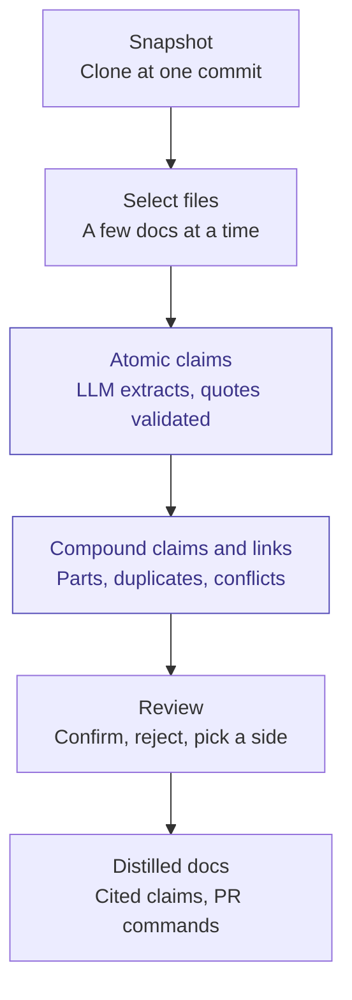
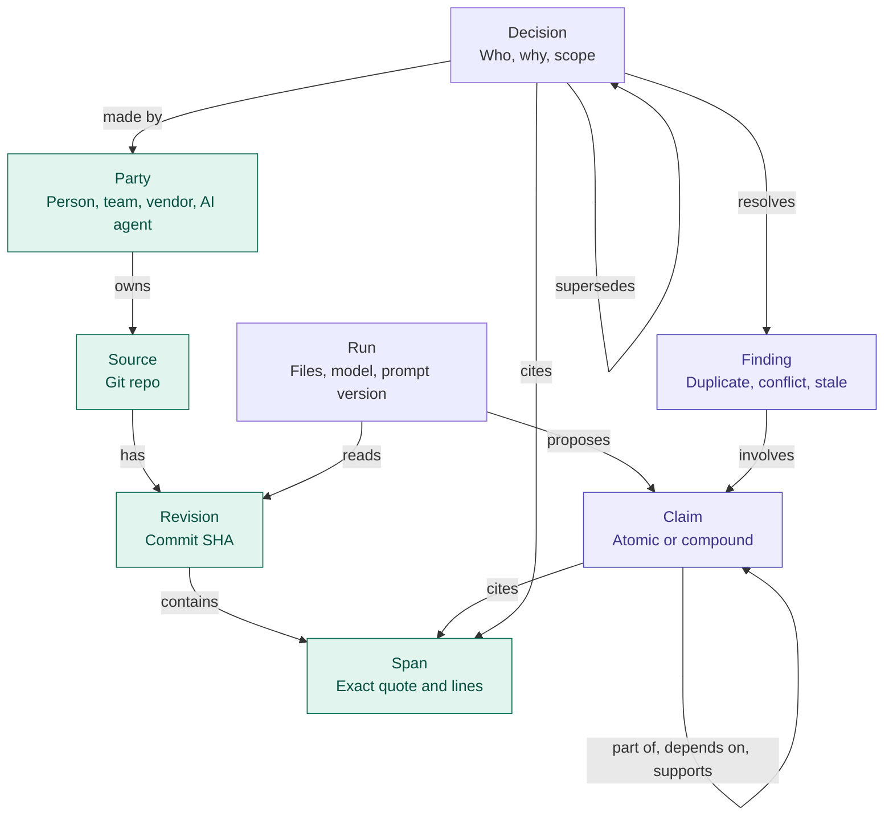

# MVP development plan

How the MVP gets built. Numbers such as M3 refer to [decisions.md](decisions.md). Everything here is settled for the MVP (M16), except items marked:

- ***Starting point:*** iterated during development.
- ***Proposal:*** not yet signed off. Choices that no decision covers are marked *Proposed by* with the agent's name, and listed in the PR, until Rachel Fish signs them off (P4).

## Terms

| Term | Meaning |
|---|---|
| MVP | The first build: Markdown docs distillation |
| v1 | The end state described in the README |
| Run | One commit, the selected files, the model and the prompt version |
| Stage | One step of document processing, from snapshot to distilled docs |
| Section | Markdown under one heading, with its line range |
| Span | Exact quote and line range at one commit |
| Atomic claim | Claim quoting one span |
| Compound claim | Claim made of other claims |
| Link | Relation between two claims |
| Finding | Duplicate, conflicting or stale claims |
| Decision | Ruling by a person on claims or findings, with a reason and cited spans |
| Party | Author of a record: person, team, vendor or AI agent |
| AI proposal | Record written by an AI agent, not yet confirmed by a person |
| Validation | Deterministic checks on model output before saving |

## Scope

| In the MVP | After the MVP |
|---|---|
| Markdown docs in a git repo, pinned to one commit (M7, M8) | PDFs (L1) |
| Claims, decisions and the review interface (M4) | Citations into source code, and checking docs against code (L2) |
| A few files per run, resumable after failures (M8) | Other model platforms (L3) |
| Progress at every stage, on the command line and the web (M9) | An ORM, chosen once the data model settles (I6) |
| Anthropic REST API behind a platform-agnostic trait (M14) | Graph and diagram views (R2) |
| Server-rendered pages on localhost, without JavaScript (M13) | CI integration (L8) |

## Stages



Purple stages produce AI proposals (P4). Everything else is deterministic or done by people.

| Stage | What it does | Guarantee |
|---|---|---|
| Snapshot | `git clone` into the clone folder, `git rev-parse HEAD`, `git ls-files` for Markdown (I8) | Commit hash recorded on the run (M8) |
| Select files | Files picked in the web interface for this run (M8) | Cached sections skipped |
| Atomic claims | Claims extracted from each section (M3, P5) | Each quote appears in its section word for word |
| Compound claims and links | Claims grouped into compound claims; related claims linked across the run's files | Every part and link points to an existing claim |
| Review | People confirm, reject, edit or pick a side, with a reason (P3) | Decisions cite spans |
| Distilled docs | Confirmed claims rendered with references, plus PR commands (M11) | Every claim kept, merged or rejected |

## Progress

The command line and the web interface show the same progress at every stage, so the interface never appears frozen (M9).

- **Progress module,** modeled on web-of-trust's `progress.rs`: stages with a label, a total and a unit; updates naming the current item; a summary line and duration at the end of each stage.
- **Terminal:** one line redrawn in place, or plain lines every few seconds when output isn't a terminal.
- **Web:** the same report on the run page, reloading every 2 seconds with `<meta http-equiv="refresh">`.
- **History:** stage summaries and durations saved with the run.

| Stage | Shown while running |
|---|---|
| Snapshot | git's clone progress: objects received, percentage |
| Select files | Markdown files found, files selected |
| Sections | Sections per file, cached and to send |
| Atomic claims | Section *n* of total, percentage, file and line range, attempt number, elapsed time of the current model call |
| Validation | Quotes and IDs validated and rejected |
| Compound claims and links | Claims sent, compound claims and links recorded |
| Retries | Reason and countdown |

Model calls have no percentage, so the run page shows a running clock per call. Streaming responses to show claims as they arrive comes later, only if long calls still look stuck.

## Data model

*Starting point*



- **Spans** are fixed to one commit, so citations stay accurate for that run (M8).
- **Atomic claims** cite exactly one span. **Compound claims** list their parts: atomic or compound claims (P5).
- **Claim links:** part of, depends on, supports, opposes, duplicates and conflicts with.
- **Authorship:** claims, links, findings and decisions record their author and status (proposed, confirmed, rejected). AI agents are parties too (C5). Records from AI agents show an "AI proposal" label in every view until a person confirms them (P4).
- **Reviewer:** decisions made through the server are recorded as the reviewer in the config file (P3).
- **Rejections flow upward:** rejected claims flag every claim that depends on them. Decisions whose support never reaches a person's confirmation are flagged as unconfirmed assumptions (C5).
- **Decisions** are never edited. Changes are new decisions that supersede the old ones (P3).

## Claim extraction

Built first (M3), in two passes. Every call forces one tool with strict tool use, so replies always match the schema, and validation checks the content. Prompts and tool schemas are files tracked in git; the prompt version is their hash (I12).

**Pass 1, atomic claims:** one call per section. Tables, lists and code blocks are sent as written, with their line numbers. No format is assumed (P6).

```json
{
  "name": "record_claims",
  "description": "Record each atomic claim in this section: one piece of information, quoted exactly.",
  "strict": true,
  "input_schema": {
    "type": "object",
    "properties": {
      "claims": {
        "type": "array",
        "items": {
          "type": "object",
          "properties": {
            "text": { "type": "string", "description": "The claim as one concise statement" },
            "kind": { "type": "string", "enum": ["behavior", "configuration", "requirement", "decision", "instruction", "rationale"] },
            "quote": { "type": "string", "description": "Exact text from the section that the claim rests on" },
            "illustrative": { "type": "boolean", "description": "True for examples, not facts about the project" }
          },
          "required": ["text", "kind", "quote", "illustrative"],
          "additionalProperties": false
        }
      }
    },
    "required": ["claims"],
    "additionalProperties": false
  }
}
```

**Pass 2, compound claims and links:** one call over the claims of the run's files, each with an ID assigned by Distillery.

```json
{
  "name": "record_compounds",
  "description": "Group claims into compound claims and record how claims relate.",
  "strict": true,
  "input_schema": {
    "type": "object",
    "properties": {
      "compounds": {
        "type": "array",
        "items": {
          "type": "object",
          "properties": {
            "text": { "type": "string" },
            "kind": { "type": "string", "enum": ["behavior", "configuration", "requirement", "decision", "instruction", "rationale"] },
            "parts": { "type": "array", "items": { "type": "string" }, "description": "IDs of the claims this compound claim is made of" }
          },
          "required": ["text", "kind", "parts"],
          "additionalProperties": false
        }
      },
      "links": {
        "type": "array",
        "items": {
          "type": "object",
          "properties": {
            "from": { "type": "string" },
            "to": { "type": "string" },
            "relation": { "type": "string", "enum": ["depends_on", "supports", "opposes", "duplicates", "conflicts"] }
          },
          "required": ["from", "to", "relation"],
          "additionalProperties": false
        }
      }
    },
    "required": ["compounds", "links"],
    "additionalProperties": false
  }
}
```

**Claim kinds** (P7), *Starting point*, draw on three existing frameworks:

| Framework | What it contributes |
|---|---|
| [FActScore](https://arxiv.org/abs/2305.14251) | Atomic facts: short statements that each contain one piece of information |
| [Diátaxis](https://diataxis.fr) | Doc types (tutorial, how-to, reference, explanation), mapping to instruction, behavior and configuration, and rationale |
| [IBIS](https://en.wikipedia.org/wiki/Issue-based_information_system) | Issues, positions and arguments that support or oppose, mapping to findings, decisions and rationale |

## Runs and failures

- **Runs:** one commit, the selected files, the model and the prompt version (M8).
- **Execution:** one run at a time, as plain synchronous code on its own thread. The command line (build step 4) and the server run the same code, and the run page reads the shared progress report. *Proposal*
- **Provider errors:** 429, 5xx and 529 responses retried with backoff, honoring `retry-after`.
- **Failed validation:** rejected claims go back to the model once with the reason. Sections failing again are marked "not distilled," with the model's output shown.
- **Long sections:** split at subheadings, then at paragraphs.
- **Incremental runs:** later runs add files at the same commit. Sections are cached by file blob hash, line range, prompt version and model, so unchanged sections are never re-sent.
- **Prompt changes:** records from older prompt versions show as needing a re-run (I12).

## Model access

- **`ModelProvider` trait** with the agent loop in Distillery (I3), and one adapter: the Anthropic Messages REST API, called through reqwest (M14, I10).
- **Tool calls:** one forced tool per call, with `"strict": true`.
- **API key:** only from the `ANTHROPIC_API_KEY` environment variable; never in the config file, the database or logs.

## Configuration

`distillery.example.toml` in the repo, copied to a git-ignored `distillery.toml`, laid out like lurkers' `lurker.example.toml` (I11):

```toml
# Distillery's settings. Copy this file to distillery.toml.

[server]
# Port on 127.0.0.1. The MVP has no login, so Distillery only serves locally.
port = 8080

[review]
# Reviewer recorded on every decision made through this server.
reviewer = "Rachel Fish"

[model]
# Anthropic model for new runs. Each run records its model.
# The API key comes only from the ANTHROPIC_API_KEY environment variable.
name = "claude-opus-5-5"

[storage]
# SQLite database, created when missing.
database = "distillery.sqlite"
# Folder for repository clones, one subfolder per repository, created when
# missing. Repositories themselves are added through the web interface.
clone_dir = "repos"
```

## Stack

| Part | Choice | Source |
|---|---|---|
| Language | Rust | I1 |
| Web server | axum, with tokio, on 127.0.0.1 | I9, M13 |
| HTML | maud; plain HTML forms, no JavaScript | M13 |
| Storage | rusqlite with bundled SQLite; schema steps tracked by `user_version`, as in web-of-trust | I6 |
| Markdown | pulldown-cmark | I7 |
| Git | Native git commands | I8 |
| Model API | reqwest | I10 |
| Settings | TOML config file | I11 |

## Build order

Each step is a small, isolated change that leaves a working program (M5).

1. **Project setup:** Cargo binary, config file, SQLite schema for the data model.
2. **Snapshot and progress:** clone a repo into the clone folder, record the commit hash, list Markdown files, with progress on the command line.
3. **Sections:** split Markdown into sections with line ranges.
4. **Atomic claims:** pass 1 with quote validation and its cache, run from the command line on chosen files, so the prompt can be tuned before any pages exist.
5. **Runs page:** add a repo URL, pick files, start a run, and watch the same progress and failures as the command line.
6. **Claims review:** each doc with its atomic claims beside the source lines; confirm, reject or edit, with a reason. AI proposals labeled (P4).
7. **Compound claims and links:** pass 2, with review of compound claims, duplicates and conflicts. Decisions cite spans, and rejections flag dependent claims.
8. **Distilled docs:** confirmed claims rendered as Markdown with references, plus PR commands.
9. **Phrasing lint:** configurable rules that catch filler and AI phrasing in claim text (M2, R9).
