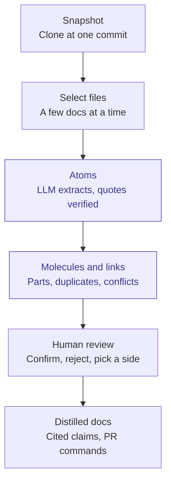
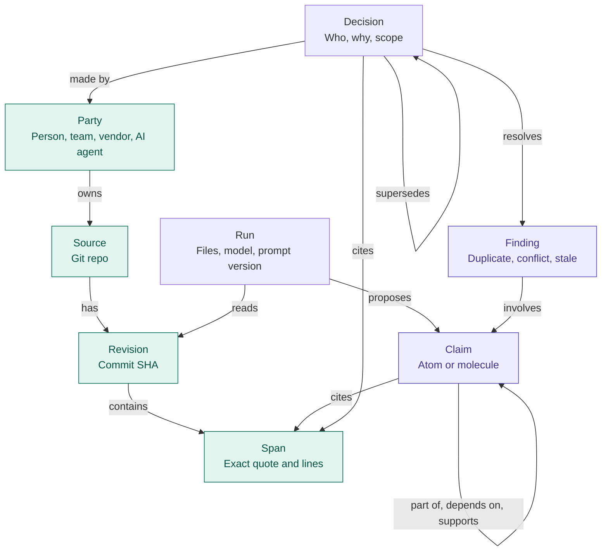

# MVP development plan

How the MVP gets built. Numbers such as M3 refer to [decisions.md](decisions.md). Anything without a decision number is Claude's proposed implementation, and needs to be discussed in the next session before development can continue. Items marked *Proposal* are choices no decision covers yet.

## Scope

| In the MVP | After the MVP |
|---|---|
| Markdown docs in a git repo, pinned to one commit (M7, M8) | PDFs (L1) |
| Claims, decisions and the review interface (M4) | Connecting docs to the code and checking them against it (L2) |
| A few files per run, resumable after failures (M8) | Other model platforms (L3) |
| Anthropic API behind a platform-agnostic trait (M13) | An ORM, chosen once the data model settles (I6) |
| Server-rendered pages (M12) | Graph and diagram views (R2) |

## Pipeline



Purple steps are LLM proposals. Everything else is deterministic or done by people.

| Stage | What it does | Check |
|---|---|---|
| Snapshot | `git clone`, `git rev-parse HEAD`, `git ls-files` for Markdown (I8) | Commit hash recorded on the run (M8) |
| Select files | The user picks which files this run processes (M8) | Cached sections are skipped |
| Atoms | Extract atomic claims from each section (M3, P4) | Each quote must appear in its section word for word |
| Molecules and links | Group atoms into molecules and link related claims across the run's files | Every part and link points to an existing claim |
| Human review | Users confirm, reject, edit or pick a side, with a reason (P3) | Decisions cite spans |
| Distilled docs | Render confirmed claims with references, plus PR commands (M10) | Every claim is kept, merged or rejected |

## Data model



- **Spans** are fixed to one commit, so citations stay accurate for that run (M8).
- **Atoms** cite exactly one span. **Molecules** list their parts, which can be atoms or other molecules (P4).
- **Claim links:** part of, depends on, supports, opposes, duplicates and conflicts with.
- **Authorship:** every claim and decision records its author and status (proposed, confirmed, rejected). AI agents are parties too (C5).
- **Rejections flow upward:** rejecting a claim flags every molecule and claim that depends on it. A decision whose support never reaches a person's confirmation is flagged as an unconfirmed assumption (C5).
- **Decisions** are never edited. A change is a new decision that supersedes the old one (P3).

## Claim extraction

Built first (M3), in two passes. The model must answer through tools, and Distillery checks every answer.

**Pass 1, atoms:** one call per section. Tables, lists and code blocks are sent as written, with their line numbers. No format is assumed (P5).

```json
{
  "name": "record_atoms",
  "description": "Record each atomic claim in this section: one piece of information, quoted exactly.",
  "input_schema": {
    "type": "object",
    "properties": {
      "atoms": {
        "type": "array",
        "items": {
          "type": "object",
          "properties": {
            "text": { "type": "string", "description": "The claim as one concise statement" },
            "kind": { "enum": ["behavior", "configuration", "requirement", "decision", "instruction", "rationale"] },
            "quote": { "type": "string", "description": "Exact text from the section that the claim rests on" },
            "illustrative": { "type": "boolean", "description": "True for examples, not facts about the project" }
          },
          "required": ["text", "kind", "quote", "illustrative"]
        }
      }
    },
    "required": ["atoms"]
  }
}
```

**Pass 2, molecules and links:** one call over the atoms of the run's files.

```json
{
  "name": "record_structure",
  "description": "Group claims into molecules and record how claims relate.",
  "input_schema": {
    "type": "object",
    "properties": {
      "molecules": {
        "type": "array",
        "items": {
          "type": "object",
          "properties": {
            "text": { "type": "string" },
            "kind": { "enum": ["behavior", "configuration", "requirement", "decision", "instruction", "rationale"] },
            "parts": { "type": "array", "items": { "type": "string" }, "description": "IDs of the claims this molecule is made of" }
          },
          "required": ["text", "kind", "parts"]
        }
      },
      "links": {
        "type": "array",
        "items": {
          "type": "object",
          "properties": {
            "from": { "type": "string" },
            "to": { "type": "string" },
            "relation": { "enum": ["depends_on", "supports", "opposes", "duplicates", "conflicts"] }
          },
          "required": ["from", "to", "relation"]
        }
      }
    },
    "required": ["molecules", "links"]
  }
}
```

**Claim kinds** (P6) draw on three existing frameworks:

| Framework | What it contributes |
|---|---|
| [FActScore](https://arxiv.org/abs/2305.14251) | Atomic facts: short statements that each contain one piece of information |
| [Diátaxis](https://diataxis.fr) | Doc types (tutorial, how-to, reference, explanation), mapping to instruction, behavior and configuration, and rationale |
| [IBIS](https://en.wikipedia.org/wiki/Issue-based_information_system) | Issues, positions and arguments that support or oppose, mapping to findings, decisions and rationale |

## Runs and failures

- **A run** is one commit, the files the user selected, the model and the prompt version (M8).
- **Execution:** one run at a time, as a background task in the server. Progress is saved per section, and the run page polls for it.
- **Provider errors** (timeouts, rate limits) are retried with backoff.
- **Failed checks:** rejected claims go back to the model once with the reason. Sections that fail again are marked "not distilled," with the model's output shown.
- **Long sections** are split at subheadings, then at paragraphs.
- **Incremental runs:** later runs add files at the same commit. Sections are cached by file blob hash, line range, prompt version and model, so unchanged sections are never re-sent.

## Model access

- **`ModelProvider` trait** with the agent loop in Distillery (I3), and one adapter: the Anthropic Messages API (M13).
- **Configuration:** API key from the `ANTHROPIC_API_KEY` environment variable; model name in the config file. *Proposal*

## Stack

| Part | Choice | Source |
|---|---|---|
| Language | Rust | I1 |
| HTML | maud | M12 |
| Web server | axum, with tokio | *Proposal* |
| Browser scripts | Plain JavaScript for progress polling and keyboard review actions; no framework | *Proposal* |
| Storage | rusqlite, schema versioned with SQLite's `user_version` | I6, *Proposal* for versioning |
| Markdown | pulldown-cmark | I7 |
| Git | Native git commands | I8 |
| Anthropic API client | reqwest | *Proposal* |

## Build order

Each step is a small, isolated change that leaves a working program (M5).

1. **Project setup:** Cargo binary, config file, SQLite schema for the data model.
2. **Snapshot:** clone a repo URL, record the commit hash, list Markdown files.
3. **Sections:** split Markdown into sections with line ranges.
4. **Atoms:** pass 1 with its quote check and cache, run from the command line on chosen files so the prompt can be tuned before any pages exist.
5. **Runs page:** paste a repo URL, pick files, start a run, watch progress and failures.
6. **Claims review:** each doc with its atoms beside the source lines; confirm, reject or edit, with a reason.
7. **Molecules and links:** pass 2, with review of molecules, duplicates and conflicts. Decisions cite spans, and rejections flag dependent claims.
8. **Distilled docs:** confirmed claims rendered as Markdown with references, plus PR commands.
9. **Phrasing lint:** configurable rules that catch filler and AI phrasing in claim text (M2).
