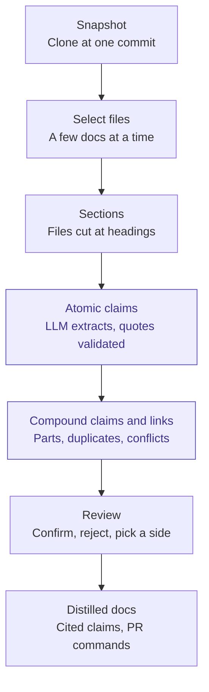
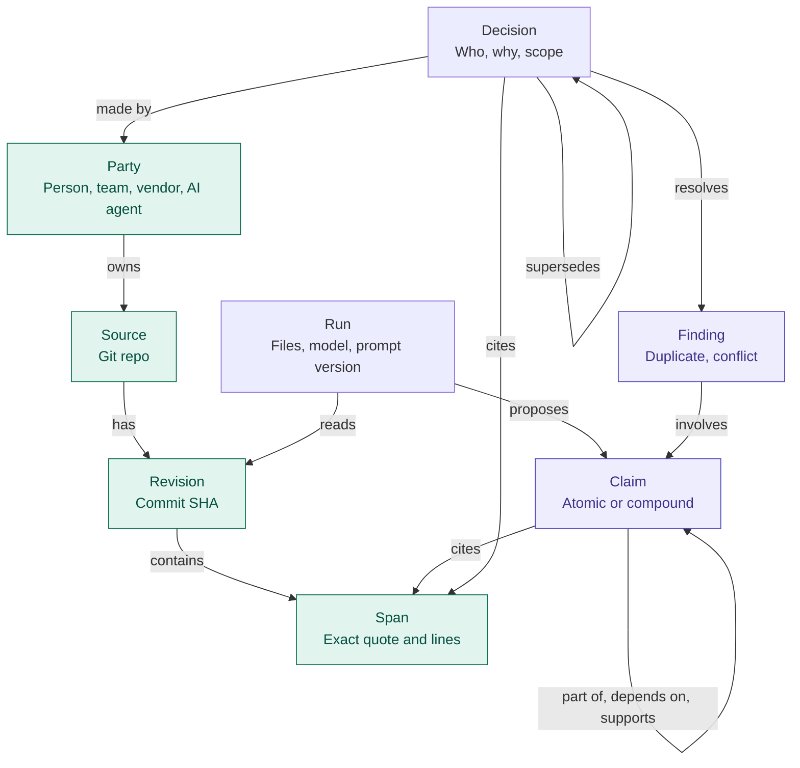

# MVP development plan

How the MVP gets built. Numbers such as M3 refer to [decisions.md](decisions.md). Everything here is settled for the MVP (M16), except items marked:

- ***Starting point:*** iterated during development.
- ***Proposal:*** not yet signed off. Choices that no decision covers are marked *Proposed by* with the agent's name, and listed in the PR, until Rachel Fish signs them off (P4).

## Terms

| Term | Meaning |
|---|---|
| MVP | The first build: Markdown docs distillation |
| v1 | The end state described in the README |
| Run | One commit, the selected files, the model and the prompt version |
| Stage | One step of document processing, from snapshot to distilled docs |
| Source | Git repo added by a user |
| Section | Markdown from one heading to the next, with its line range and heading path |
| Span | Exact quote and line range at one commit |
| Atomic claim | Claim quoting one span |
| Compound claim | Claim made of other claims |
| Link | Relation between two claims |
| Finding | Duplicate or conflicting claims |
| Decision | Ruling by a person on claims or findings, with a reason and cited spans |
| Party | Author of a record: person, team, vendor or AI agent |
| AI proposal | Record written by an AI agent, not yet confirmed by a person |
| Validation | Deterministic checks on model output before saving |
| Job | Long work started from a page, one at a time, with progress |
| Model call | One request to a model API, recorded with its tokens and cost |

## Scope

| In the MVP | After the MVP |
|---|---|
| Markdown docs in a git repo, pinned to one commit (M7, M8) | PDFs, then plain text and HTML docs (L1) |
| Claims, decisions and the review interface (M4) | Citations into source code, and checking docs against code (L2) |
| A few files per run, resumable after failures (M8) | Other model platforms (L3) |
| Progress at every stage, on the command line and the web (M9) | An ORM, chosen once the data model settles (I6) |
| Anthropic REST API behind a platform-agnostic trait (M14) | Graph and diagram views (R2) |
| Server-rendered pages on localhost, without JavaScript (M13) | CI integration (L8) |
| Stale claims and needless detail, as review outcomes | Staleness detection, which needs code checks (L2) |
| Usage and cost of every model call, estimates, and a cost limit per run (M18) | Prompt caching and extended thinking, after a trade study (M20) |
| Synchronous runs, one job at a time (M19) | Docs files processed in parallel (M19) |

## Stages



Purple stages produce AI proposals (P4). Everything else is deterministic or done by people.

| Stage | What it does | Guarantee |
|---|---|---|
| Snapshot | Bare `git clone` with full history into the clone folder, or `git fetch` for known repositories; `git rev-parse` for the commit; `git ls-tree` for `.md` and `.markdown` files (I8) | Commit hash recorded on the run (M8) |
| Select files | Runs start from the File page, one file per run; several files per run follow (M8). An estimate page shows tokens and cost first (M18) | Cached sections skipped |
| Sections | Each file cut at its headings (M21) | Every section has a line range at the commit |
| Atomic claims | Claims extracted from each section (M3, P5) | Each quote appears in its section word for word, ignoring whitespace differences |
| Compound claims and links | Claims grouped into compound claims; related claims linked across all files distilled at the commit | Every part and link points to an existing claim |
| Review | People confirm, reject, edit or pick a side (P3). Rejections, edits and picked sides need a reason; confirmations can omit it | Decisions cite spans |
| Distilled docs | Confirmed claims rendered with references, plus PR commands (M11) | Every claim kept, merged or rejected |

## Progress

The command line and the web interface show the same progress at every stage, so the interface never appears frozen (M9).

- **Progress module,** modeled on web-of-trust's `progress.rs`: stages with a label, a total and a unit; updates naming the current item; a summary line and duration at the end of each stage.
- **Terminal:** one line redrawn in place, or plain lines every few seconds when output isn't a terminal.
- **Web:** the same report on the Job page, reloading every 2 seconds with `<meta http-equiv="refresh">`.
- **History:** stage summaries and durations saved with the run.

| Stage | Shown while running |
|---|---|
| Snapshot | git's own clone and fetch progress: objects received, percentage |
| Select files | Markdown files found, files selected |
| Sections | Sections per file, cached and to send |
| Atomic claims | Section *n* of total, percentage, file and line range, attempt number, elapsed time of the current model call |
| Validation | Quotes and IDs validated and rejected |
| Compound claims and links | Claims sent, compound claims and links recorded |
| Retries | Reason and countdown |

Model calls have no percentage, so the Job page shows a running clock per call. Streaming responses to show claims as they arrive comes later, only if long calls still look stuck.

## Data model

*Starting point*



- **Spans** are fixed to one commit, so citations stay accurate for that run (M8).
- **Atomic claims** cite exactly one span. **Compound claims** list their parts: atomic or compound claims (P5).
- **Claim links:** part of, depends on, supports, opposes, duplicates and conflicts with.
- **Authorship:** claims, links, findings and decisions record their author and status (proposed, confirmed, rejected). AI agents are parties too (C5). Records from AI agents show an "AI proposal" label in every view until a person confirms them (P4).
- **Reviewer:** decisions made through the server are recorded as the reviewer in the config file (P3).
- **Rejections flow upward:** rejected claims flag every claim that depends on them. Decisions whose support never reaches a person's confirmation are flagged as unconfirmed assumptions (C5).
- **Decisions** are never edited. Changes are new decisions that supersede the old ones (P3).
- **Stale claims and needless detail** are review outcomes: rejected claims and losing sides of conflicts. Conflict review shows the last commit date of each file.
- **Schema:** each build step adds the tables it needs as a new schema step. No table exists before the code that uses it (I6). Built so far: `sources`, `revisions` and `model_calls`. Markdown file lists, file contents and sections are read from git on demand and not stored (I8).

## Web interface

Built before sections and claim extraction, so every later step is checked in the browser (M17). `distillery serve` starts it.

| Page | Shows | Actions |
|---|---|---|
| Sources | Sources with their latest commit | Add a source by URL; fetch latest |
| Source | Recorded commits, and the Markdown files at one of them | Fetch latest |
| File | Markdown source at a commit, with line numbers and sections | "Distill", from build step 5 |
| Job | Progress and outcome of the job under way or last run | None |
| Usage | Settings in use, usage totals, latest model calls | Check API key |

- **Source text, not HTML:** claims cite source lines, so the File page shows Markdown source and never renders it.
- **Addresses** only reach recorded commits and the Markdown files listed at them.
- **Jobs:** one at a time, on its own thread, with no JavaScript.

## Sections

A proof of concept, open to change when testing shows problems (M21):

- **Boundaries:** sections run from one heading to the next heading of any level. Parent headings form the heading path, sent to the model as context.
- **Before the first heading:** its own section.
- **Code blocks, lists and block quotes** stay whole inside their section: a `#` line inside them never starts a section.
- **Front matter,** the `---` block of settings that opens some Markdown files, is metadata and never a heading.
- **Trailing blank lines** belong to no section.
- **Long sections** aren't split. Whether and how to split them is decided from the first real runs.

## Claim extraction

The essence of the MVP (M3), in two passes. Every call forces one tool with strict tool use, so complete replies match the schema, and validation checks the content. Replies cut off at the token limit and refusals are outside that guarantee: the stop reason is checked first, and both count as failed sections. Prompts and tool schemas are files in `prompts/`, tracked in git and built into the binary; the prompt version is their `git hash-object` hash (I12).

**Pass 1, atomic claims:** one call per section. Tables, lists and code blocks are sent as written. No format is assumed (P6). Distillery finds each quote in its section, ignoring whitespace differences, and derives the span's line range.

```json
{
  "name": "record_claims",
  "description": "Record each atomic claim in this section: one piece of information, quoted exactly.",
  "strict": true,
  "input_schema": {
    "type": "object",
    "properties": {
      "claims": {
        "type": "array",
        "items": {
          "type": "object",
          "properties": {
            "text": { "type": "string", "description": "The claim as one concise statement" },
            "kind": { "type": "string", "enum": ["behavior", "configuration", "requirement", "decision", "instruction", "rationale"] },
            "quote": { "type": "string", "description": "Exact text from the section that the claim rests on" },
            "illustrative": { "type": "boolean", "description": "True for examples, not facts about the project" }
          },
          "required": ["text", "kind", "quote", "illustrative"],
          "additionalProperties": false
        }
      }
    },
    "required": ["claims"],
    "additionalProperties": false
  }
}
```

**Pass 2, compound claims and links:** one call over all claims at the run's commit that aren't rejected, including claims from earlier runs, each with an ID assigned by Distillery.

```json
{
  "name": "record_compounds",
  "description": "Group claims into compound claims and record how claims relate.",
  "strict": true,
  "input_schema": {
    "type": "object",
    "properties": {
      "compounds": {
        "type": "array",
        "items": {
          "type": "object",
          "properties": {
            "text": { "type": "string" },
            "kind": { "type": "string", "enum": ["behavior", "configuration", "requirement", "decision", "instruction", "rationale"] },
            "parts": { "type": "array", "items": { "type": "string" }, "description": "IDs of the claims this compound claim is made of" }
          },
          "required": ["text", "kind", "parts"],
          "additionalProperties": false
        }
      },
      "links": {
        "type": "array",
        "items": {
          "type": "object",
          "properties": {
            "from": { "type": "string" },
            "to": { "type": "string" },
            "relation": { "type": "string", "enum": ["depends_on", "supports", "opposes", "duplicates", "conflicts"] }
          },
          "required": ["from", "to", "relation"],
          "additionalProperties": false
        }
      }
    },
    "required": ["compounds", "links"],
    "additionalProperties": false
  }
}
```

**Claim kinds** (P7), *Starting point*, draw on three existing frameworks:

| Framework | What it contributes |
|---|---|
| [FActScore](https://arxiv.org/abs/2305.14251) | Atomic facts: short statements that each contain one piece of information |
| [Diátaxis](https://diataxis.fr) | Doc types (tutorial, how-to, reference, explanation), mapping to instruction, behavior and configuration, and rationale |
| [IBIS](https://en.wikipedia.org/wiki/Issue-based_information_system) | Issues, positions and arguments that support or oppose, mapping to findings, decisions and rationale |

## Runs and failures

- **Runs:** one commit, the selected files, the model and the prompt version (M8).
- **Execution:** one run at a time, as plain synchronous code on its own thread, with the Job page reading the shared progress report. Processing files in parallel, such as one process per docs file for whole repos, comes later where it shortens runs (M19).
- **Provider errors:** 429, 5xx and 529 responses retried with backoff, honoring `retry-after`.
- **Incomplete replies:** replies cut off at the token limit and refusals mark the section "not distilled" (I15).
- **Failed validation:** rejected claims go back to the model once with the reason. Sections failing again are marked "not distilled," with the model's output shown.
- **Cost limit:** runs stop once their recorded cost passes `max_run_cost` (M18).
- **Incremental runs:** later runs add files at the same commit. Sections are cached by file blob hash, line range, prompt version and model, so unchanged sections are never re-sent.
- **Prompt changes:** records from older prompt versions show as needing a re-run (I12).

## Usage and cost

Modeled on Wetfish Success's `ai_usage_events` (M18):

- **Every model call is recorded** in `model_calls`, failures and retries included: provider, model, operation, tokens in and out, cache tokens, cost, duration, stop reason and error. Runs add the run, file and section.
- **Cost** is stored in millionths of a US dollar, computed at call time from the configured prices, so later price changes don't rewrite history.
- **Estimates:** before a run, the estimate page shows sections to send, sections cached, input tokens and input cost. Counting tokens is free. Output cost is estimated from the output-to-input ratio of past calls.
- **Usage page:** totals by model, operation and day, and the latest calls with errors.
- **No prompt caching or extended thinking** in the MVP (M20). The cache token columns exist for later.

## Model access

- **`ModelProvider` trait** with the agent loop in Distillery (I3), and one adapter: the Anthropic Messages REST API, called through reqwest (M14, I10).
- **Tool calls:** one forced tool per call, with `"strict": true`.
- **API key:** the `model.api_key` setting in the git-ignored `distillery.toml` (I11); never in the database, logs, pages or error messages.

## Local requests only

The MVP has no login (M13), so the server rejects every non-local request:

- **Requests:** rejected unless the `Host` header is the server's own 127.0.0.1 or localhost address.
- **Form posts:** rejected unless the `Origin` header is local too, so other websites can't record decisions under the reviewer's name.
- **Clones:** repository URLs are passed to git after `--`, limited to https and ssh, with credential prompts turned off. Clones are bare, so no checkout filters or hooks run.

## Configuration

`distillery.example.toml` in the repo, copied to a git-ignored `distillery.toml`, laid out like lurkers' `lurker.example.toml` (I11):

```toml
# Distillery's settings. Copy this file to distillery.toml.

[server]
# Port on 127.0.0.1. The MVP has no login, so Distillery only serves locally.
port = 8080

[review]
# Reviewer recorded on every decision made through this server.
reviewer = "Rachel Fish"

[model]
# Anthropic model for new runs. Each run records its model.
name = "claude-opus-5-5"
# Anthropic API key, from https://platform.claude.com/settings/keys
# Keep it in distillery.toml only, which git ignores.
api_key = ""
# Prices in US dollars per million tokens, used for the cost recorded with
# each API call. Change them together with the model:
# https://platform.claude.com/docs/en/about-claude/pricing
input_price = 4.00
output_price = 20.00
# Runs stop once their recorded cost passes this many US dollars.
max_run_cost = 2.00

[storage]
# SQLite database, created when missing.
database = "distillery.sqlite"
# Folder for repository clones, one subfolder per repository, created when
# missing. Repositories themselves are added through the web interface.
clone_dir = "repos"
```

Unknown settings are errors. Only `review.reviewer` is required.

## Stack

| Part | Choice | Source |
|---|---|---|
| Language | Rust | I1 |
| Web server | axum, with tokio, on 127.0.0.1 | I9, M13 |
| HTML | maud; plain HTML forms, no JavaScript | M13 |
| Storage | rusqlite with bundled SQLite; schema steps tracked by `user_version`, as in web-of-trust | I6 |
| Markdown | pulldown-cmark | I7 |
| Git | Native git commands | I8 |
| Model API | reqwest's blocking client with rustls, and serde_json | I10 |
| Settings | TOML config file, read with the toml and serde crates, as in lurkers | I11 |
| Command line | clap derive, as in web-of-trust: `distillery serve` and `distillery snapshot URL`, with `--config FILE` for other settings files | I13 |
| Tests | Unit tests beside the code, as in web-of-trust and lurkers; a stub `ModelProvider` for model calls. Written at the end of each feature | I14, R11 |

## Build order

Each step is a small, isolated change that leaves a working program (M5). Iteration commits carry manual QA steps; tests and docs come in the last step (R11).

| # | Step | Status |
|---|---|---|
| 1 | **Project setup:** Cargo binary, config file, database with versioned schema steps | Done |
| 2 | **Snapshot and progress:** clone or fetch a source, record the commit, list Markdown files | Done |
| 3 | **Web interface:** server, Sources, Source, File and Job pages | Done |
| 4 | **Sections:** files cut at headings, shown on the File page | Done |
| 5.1 | **Model access and usage:** Anthropic client, price and limit settings, `model_calls`, Usage page | Done |
| 5.2 | **Estimate page:** "Distill" on the File page leads to tokens and cost, at no cost | |
| 5.3 | **Extraction run:** pass 1 with quote validation, the per-section cache and the cost limit; claims shown under their sections | |
| 5.4 | **Several files per run:** file selection on the Source page | |
| 6 | **Claims review:** confirm, reject or edit beside the source lines. AI proposals labeled (P4) | |
| 7 | **Compound claims and links:** pass 2 first, then review of compound claims, duplicates and conflicts. Decisions cite spans, and rejections flag dependent claims | |
| 8 | **Distilled docs:** confirmed claims rendered as Markdown with references, plus PR commands | |
| 9 | **Phrasing lint:** configurable rules that catch filler and AI phrasing in claim text (M2, R9) | |
| 10 | **Finish:** tests for steps 3 onward, and docs | |

Step 5.3 adds the `runs`, `extractions`, `spans` and `claims` tables. `extractions` is the per-section cache and holds the raw reply.

## Proposed by Fable

Choices no decision covers (P4), with their sign-off status:

| Build step | Choice | Status |
|---|---|---|
| 1 | `review.reviewer` is the only required setting; the rest default to the values in `distillery.example.toml` | Signed off |
| 1 | Unknown settings are errors | Signed off |
| 1 | `Cargo.lock` committed | Signed off |
| 2 | Commands through clap derive, with `--config FILE` | Signed off |
| 2 | Bare clones with full history; known repositories fetched | Signed off |
| 2 | Clone folders named after the URL's host and path | Signed off |
| 2 | `sources` and `revisions` tables; Markdown files listed from git on demand | Signed off |
| 2 | Git's own progress output for clones and fetches | Signed off |
| 2 | https URLs holding user names or tokens rejected, since URLs are stored | Signed off |
| 2 | Symbolic links and submodules skipped when listing Markdown files | Signed off |
| 3 | Pages named "Sources", following the Terms table | Signed off |
| 3 | Git's latest progress line captured and shown on the Job page and the terminal | Signed off |
| 3 | Addresses only reach recorded commits and the Markdown files listed at them | Signed off |
| 4 | Section rules, as a proof of concept | Signed off |
| 4 | Front matter read as metadata, never as a heading | Signed off |
| 5 | Cost in millionths of a dollar; default prices of $4 and $20 per million tokens; `max_run_cost` of $2.00 | Signed off |
| 5 | Prompt version from `git hash-object`; no hashing crate | Signed off |
| 5 | Sections cut off at the token limit marked "not distilled" until real runs show how often it happens | Signed off |
